# YetSignal

A system that senses people in a room using Wi-Fi signals instead of cameras or microphones. ESP32 sensor nodes capture Wi-Fi Channel State Information (CSI), and a local server turns it into presence, people count, movement, fall alerts and breathing rate, shown on a live web dashboard.

## Features

- **Live Dashboard:** Presence, people count, activity, breathing and heart rate, an activity heatmap, a live CSI chart and an event log.
- **3D Mesh:** The sensor nodes shown in a 3D room that you can rotate and zoom.
- **Fall Detection:** Raises an alert when a sudden movement is followed by stillness.
- **History:** Charts of presence, people count, motion and breathing for the last 1, 6 or 24 hours.
- **Privacy Mode:** One switch pauses all sensing. Everything is processed locally and raw signal data is not stored.
- **Simulator:** Virtual sensor nodes and people, so the whole system can run without any hardware.
- **Home Assistant:** Sends presence and alerts over MQTT.
- **Two Languages:** English and Ukrainian.

Built with TypeScript and Node.js (server), React and Three.js (dashboard), Rust (fast signal processing) and C with ESP-IDF (sensor firmware).

---

## Screens

### Dashboard
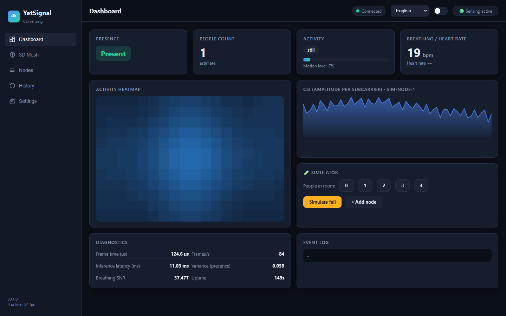

### 3D Mesh
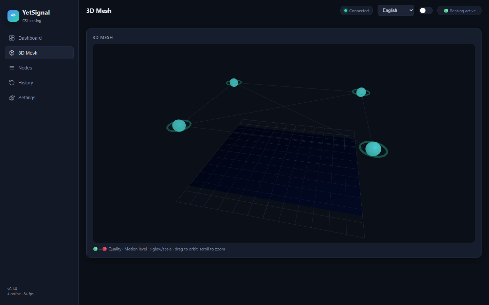

### Nodes
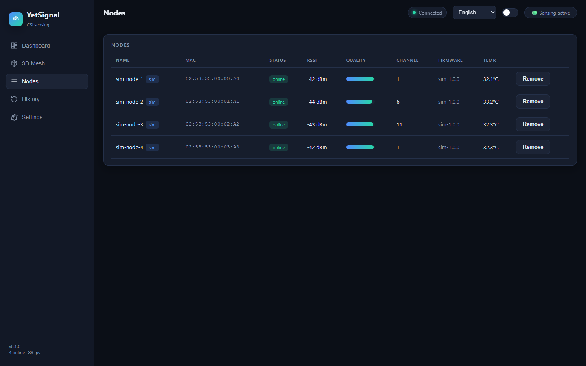

### History
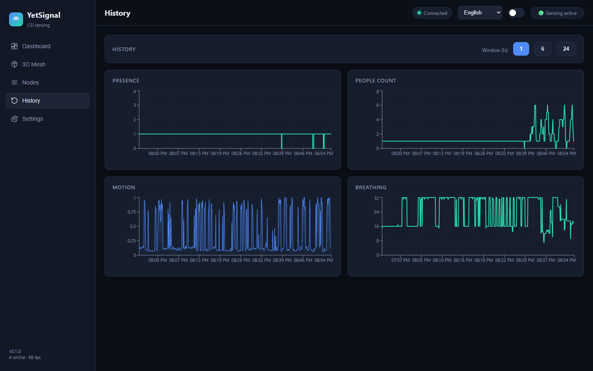

### Settings
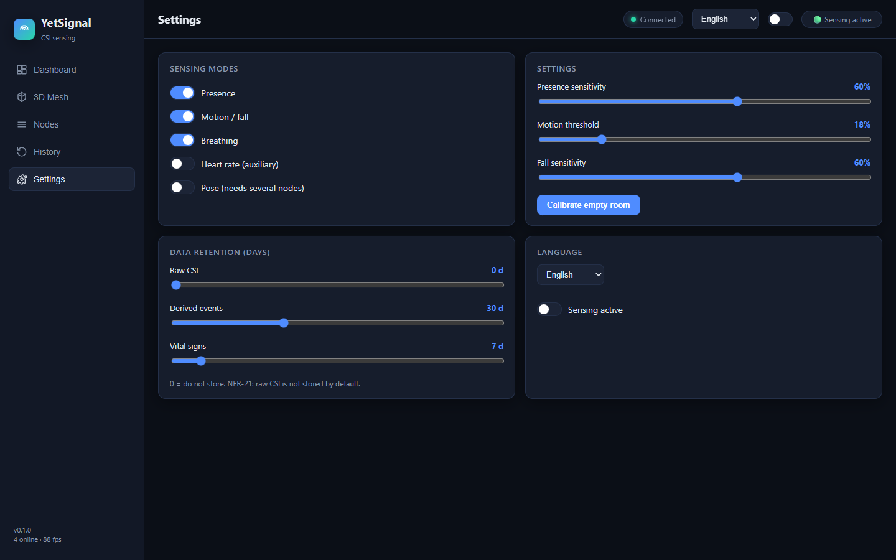

### Privacy Mode
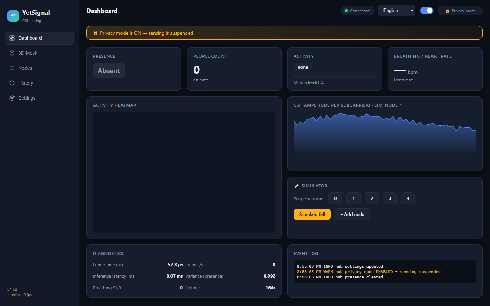

### Simulator: Empty Room
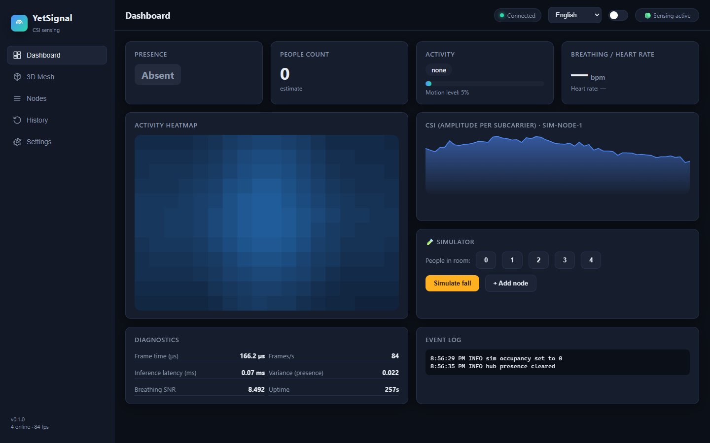

### Simulator: Person Resting (breathing and heart rate)
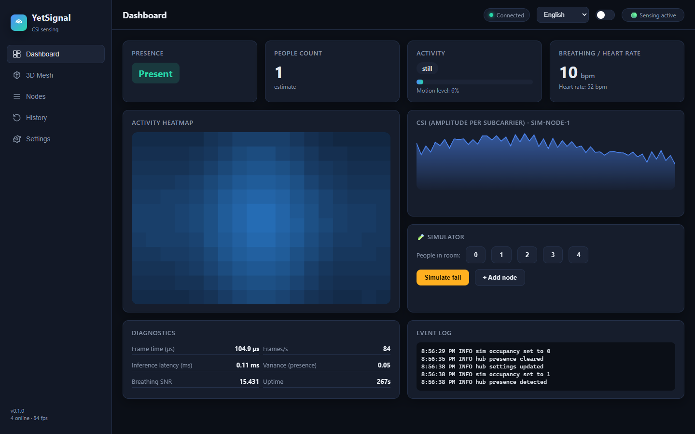

### Simulator: Fall Detected
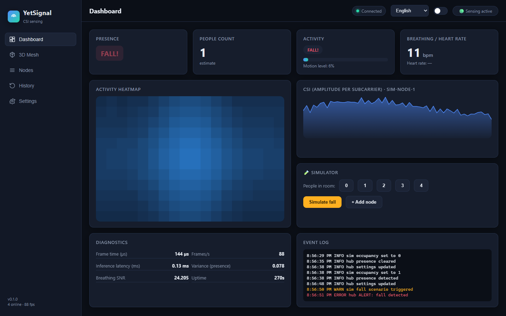

### Simulator: Three People
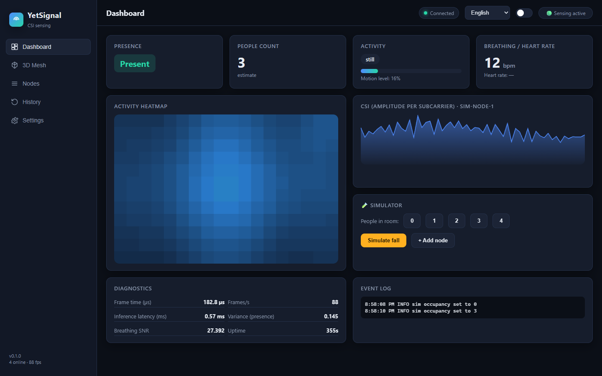
<br>


### Simulator: New Sensor Node
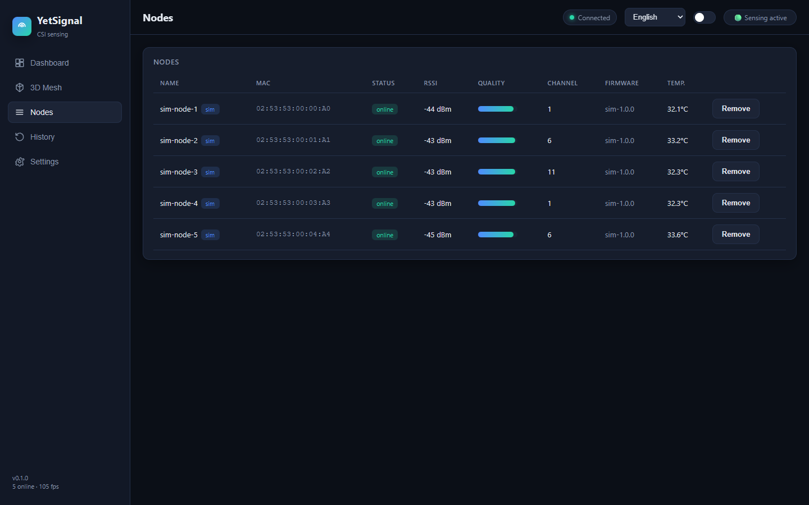
<br>
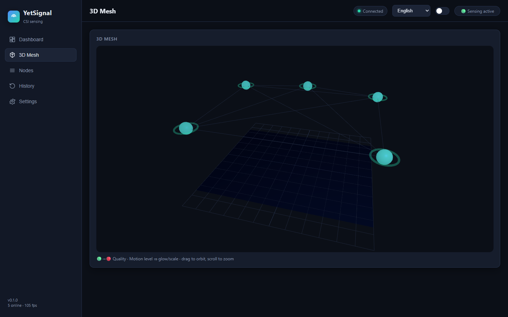

All screenshots were taken with the built-in simulator.

## Run it

**Windows app:** Download the `dist` folder from Releases and double-click `YetSignal.exe`, then open http://localhost:8787. To try it without sensors, set `"simNodes": 4` in `yetsignal.config.json`.

**From source** (Node.js 22 or newer):

```bash
npm run install:all
npm run dev
```

Setup details, configuration and the sensor firmware are in [docs/SETUP.md](docs/SETUP.md) and [firmware/README.md](firmware/README.md).
